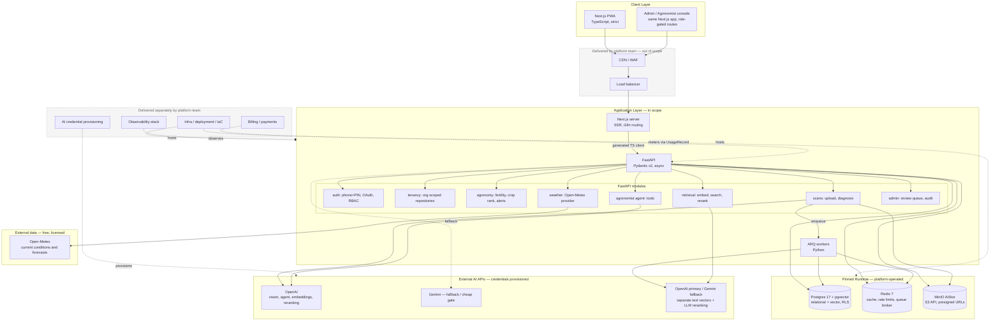
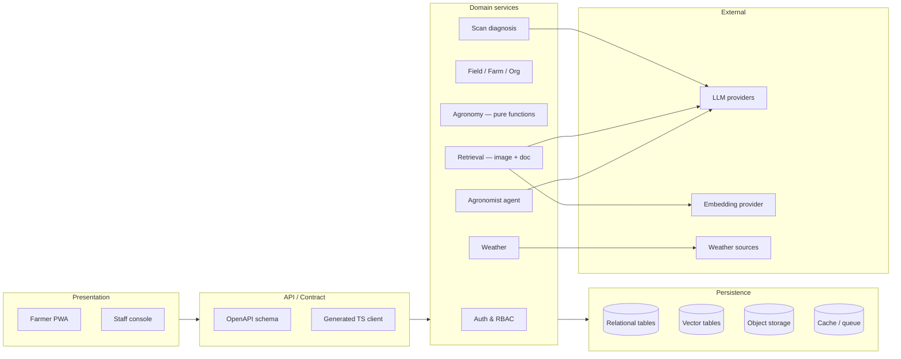
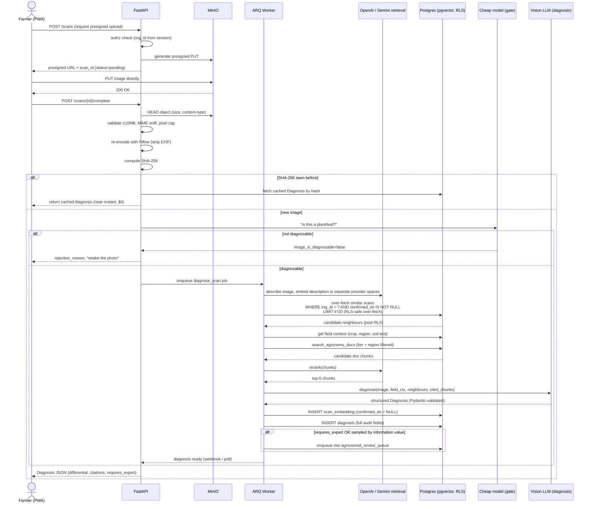
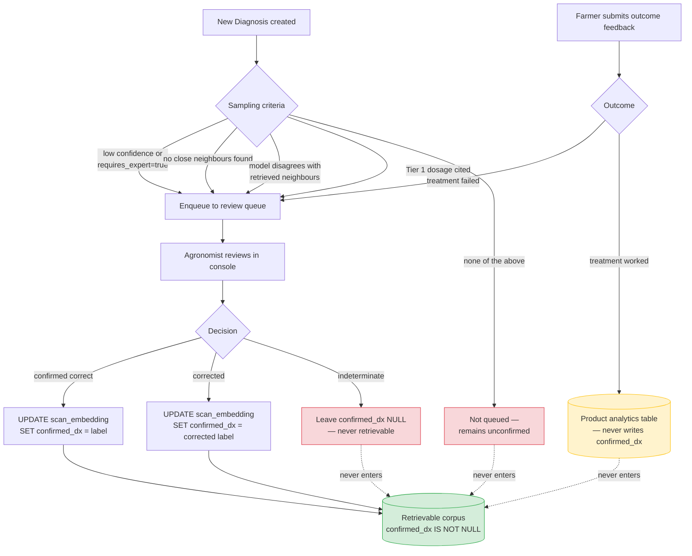
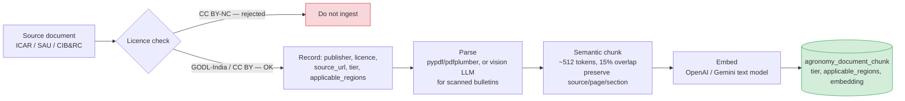
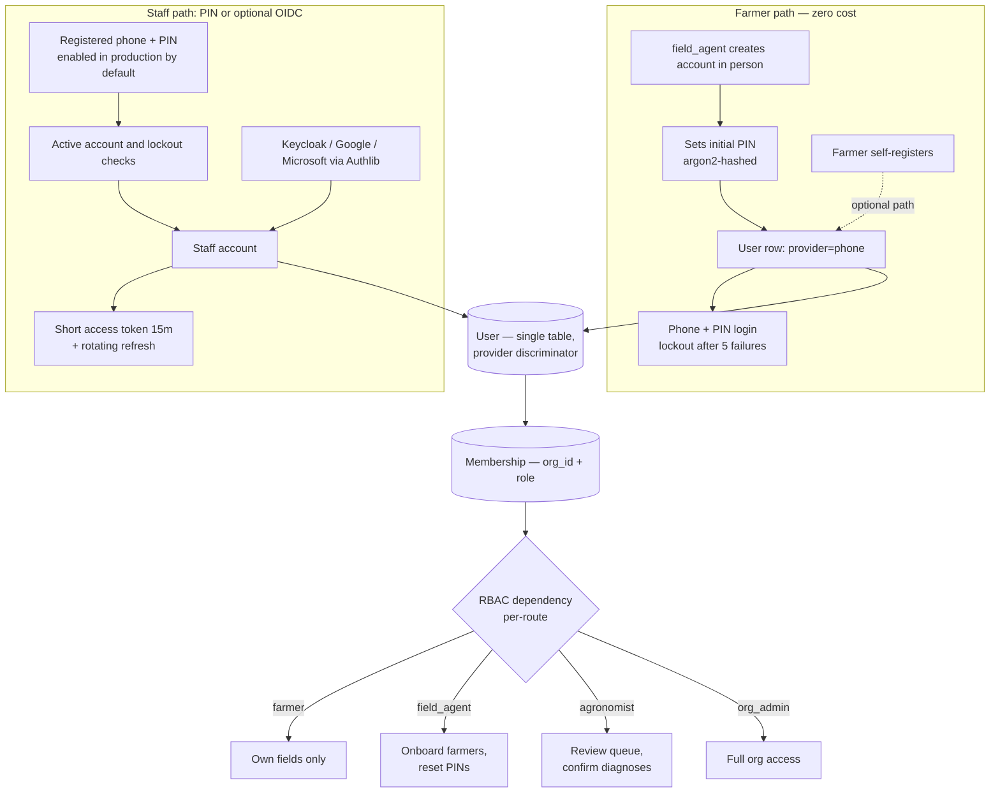
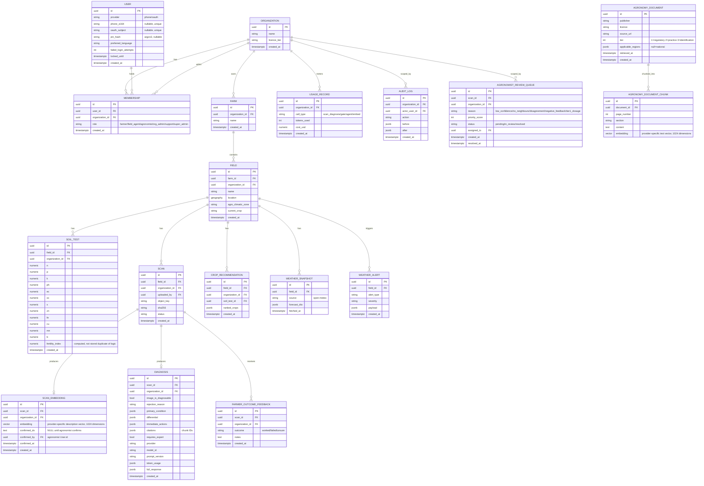

per # AgriVerse — Production-Grade Architecture, Data Flow & ER Diagram

Companion document to the AgriVerse Production Application Audit & Build Plan. Reflects the resolved decisions: FastAPI + Pydantic, Postgres 17 + pgvector, MinIO AIStor, Redis + ARQ, phone+PIN farmer and staff auth, optional staff OIDC, tiered agronomy corpus, and agronomist-gated retrieval.

---

## 1. Production-Grade Architecture

### 1.1 Component view

**Reading this diagram:**
- **Everything inside "Application Layer" is what gets built** in the 10–13 week engagement. Everything greyed out (Edge, Out) is delivered separately by the platform team and only touched at an integration boundary (e.g. `UsageRecord` rows for billing to meter against).
- **Data flows through exactly three platform-operated services** (Postgres, Redis, MinIO) plus AI provider APIs — nothing else needs to be operated by a licensee.
- **The agent (`AGENTM`) and scan diagnosis (`SCANM`) are the only modules that call frontier LLMs directly** — everything else in the app is deterministic Python or retrieval.

### 1.2 Layered / logical view

This is the same system described two ways: §1.1 shows *where data physically moves*; §1.2 shows *what depends on what conceptually* — domain services never call external providers except through the narrow `VisionProvider` / `EmbedProvider` / `WeatherProvider` interfaces defined in the main plan, so any layer can be tested by substituting a fake at that boundary.

---

## 2. Data Flow Diagrams

### 2.1 Scan diagnosis — the core product flow

Key properties this flow enforces:
- **Cost avoidance is structural, not incidental** — SHA-256 cache and the cheap-model gate sit *before* any expensive call, not after.
- **Retrieval happens twice, differently** — image neighbours (accuracy) and document chunks (citation safety) — and both are tenant-filtered with the over-fetch pattern required by RLS + HNSW.
- **The diagnosis is never written as ground truth** — `scan_embedding.confirmed_dx` stays `NULL` until an agronomist confirms it (see §2.2), regardless of how confident the model was.

### 2.2 Agronomist review queue — how a diagnosis becomes retrievable

This is the diagram version of the single most important rule in §C4.2 of the main plan: **there is exactly one write path into the retrievable corpus** — an agronomist's `confirmed_dx` write — and farmer feedback, however useful, only ever routes *toward* that path, never around it.

### 2.3 Document ingestion — building the citation corpus

At query time (§2.1), retrieval filters on `tier` (a dosage claim requires Tier 1) and `applicable_regions` (a Kerala field never retrieves a Punjab-only document) *before* reranking — both are `WHERE` clauses, not prompt instructions, per the plan's "enforce in the retrieval filter, not the prompt" rule.

### 2.4 Farmer & staff onboarding

---

## 3. Entity-Relationship Diagram

### 3.1 Notes on the schema

- **Every tenant-scoped table carries `organization_id` directly**, even where it's technically derivable through a join (e.g. `SCAN_EMBEDDING` could derive org via `SCAN`). This is deliberate redundancy: RLS policies apply a flat `organization_id = current_setting('app.org_id')` predicate on each table independently, which is what makes the raw-SQL vector queries in §2.1 safe without relying on join correctness at query time.
- **`SCAN_EMBEDDING.confirmed_dx` is nullable by design** — its nullability *is* the corpus-membership gate described in §2.2, enforced at the query level (`WHERE confirmed_dx IS NOT NULL`) rather than via a separate boolean flag that could drift out of sync.
- **`DIAGNOSIS` is deliberately wide and denormalized** (`full_response`, `token_usage` as JSONB) — this table is the audit trail for dispute resolution and eval regression, so it intentionally keeps more than a normalized schema would, per the plan's "every diagnosis logged... for review, dispute resolution and eval regression" control.
- **`AGRONOMY_DOCUMENT.tier` and `applicable_regions` are `NOT NULL` at the document level**, not the chunk level — tier and licensing are properties of the source document, not of an individual chunk, so this avoids re-deriving them per chunk at retrieval time.
- **`FARMER_OUTCOME_FEEDBACK` is intentionally a separate table from `SCAN_EMBEDDING`**, not a column on it — this is the schema-level enforcement of "farmer feedback never writes `confirmed_dx` directly" from §2.2; the two tables can only be joined, never conflated.
- **`vector` column dimensions are placeholders ("dim N")** — use the configured 1024 dimensions for both separate provider columns and pin the schema dimension; changing it later requires re-embedding the full corpus, as noted in the main plan.
